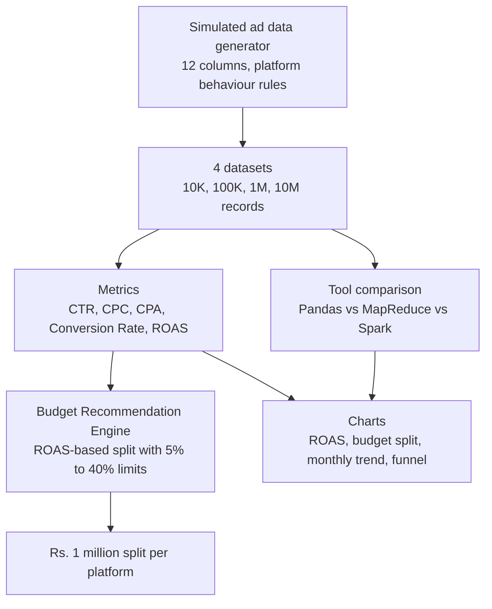

# 📈 Digital Advertising Budget Optimizer

### Big Data Analytics Project: Ad Performance Analysis, Pandas vs MapReduce vs Spark, and a Budget Recommendation Engine


**Course:** Big Data Analytics | **University:** UMT
**Name:** ________ | **Roll No:** ________

---

## 📌 1. Project Story & Business Background

> **The Core Business Question:**
> *"A company spends on Facebook, Instagram, Google, TikTok and YouTube. Where should the next Rs. 1 million be spent?"*

Digital marketing teams run campaigns on many platforms at once, and every platform produces a very large amount of data (impressions, clicks, spend, conversions, revenue). Management needs a clear answer, not a pile of numbers.

This project answers that question in four steps:

- **Which platform gives the best return?** (ROAS, CPA, CPC, CTR and conversion rate per platform)
- **How does data size change the tool we should use?** (Pandas vs MapReduce vs Spark on 10K, 100K, 1M and 10M records)
- **How should Rs. 1 million be split?** (percentage budget per platform, with safety limits)
- **What should the company do next?** (practical recommendations)

> **Note:** the company's real ad data is not available, so the data is **simulated**, as required by the course. Each platform was given its own behaviour (for example, TikTok has cheap impressions but low conversion, and Google costs more but converts better).
>
> **Campaigns are Pakistani dramas** (Mere Humsafar, Tere Bin, Kabhi Main Kabhi Tum, Sunn Mere Dil, Ishq Murshid). A brand promotes a drama through teasers, clips and reels, so every drama campaign can run on all five platforms. Because drama content lives mostly on YouTube, **40% of the records are YouTube**, and the rest is spread over Facebook (20%), Instagram (15%), TikTok (15%) and Google (10%).

---

## 🔬 2. Project Pipeline



**Dataset columns:** `date, campaign, platform, impressions, clicks, spend, conversions, revenue, age, gender, city, device`

**Metrics:**

| Metric | Formula |
|---|---|
| CTR | clicks / impressions |
| CPC | spend / clicks |
| CPA | spend / conversions |
| Conversion Rate | conversions / clicks |
| ROAS | revenue / spend |

---

## 📊 3. Key Findings

### 1. Budget recommendation (Rs. 1,000,000)

| Platform | ROAS | Budget % | Budget (Rs.) |
|---|---|---|---|
| Google | 16.82 | 40.0 | 400,003 |
| Facebook | 6.72 | 18.2 | 181,868 |
| Instagram | 6.65 | 18.0 | 179,887 |
| TikTok | 5.61 | 15.2 | 151,685 |
| YouTube | 3.20 | 8.7 | 86,556 |

Google has the highest ROAS by a large margin. Its pure ROAS-based share would be about 43%, but a **maximum limit of 40%** (and a minimum of 5% for every platform) keeps the risk from sitting on one platform.

### 2. Pandas vs MapReduce vs Spark (time in seconds)

| Size | Pandas | MapReduce | Spark |
|---|---|---|---|
| 10K | 0.054 | 0.137 | 6.831 |
| 100K | 0.367 | 0.697 | 2.308 |
| 1M | 2.131 | 7.717 | 3.084 |
| 10M | 26.968 | not run | 23.068 |

- **Small data:** Pandas is fastest. Spark has a fixed start-up cost that is bigger than the actual work.
- **10M records:** Spark overtakes Pandas because it reads the file in parallel partitions on all CPU cores.
- **Scaling:** from 1M to 10M, Pandas time grew about 13 times and Spark time about 7.5 times.
- **MapReduce:** slowest, because it processes one row at a time in Python. It was skipped at 10M.
- Spark session start-up (about 20 s) was measured separately and is not in the table.

### 3. Other analysis in the notebook

ROAS is also grouped by **campaign (drama), city and device**, and shown as a **monthly spend vs revenue trend** and a **funnel chart** (CTR and conversion rate per platform).

---

## 🖼️ 4. Visualizations

| File | Chart | What it shows |
|---|---|---|
| `charts.png` | ROAS by Platform | Which platform returns the most per rupee spent |
| `charts.png` | Recommended Budget Split | How Rs. 1 million is divided among the platforms |
| `charts.png` | Processing Time by Data Size | Pandas vs MapReduce vs Spark as data grows |
| `monthly_trend.png` | Monthly Spend vs Revenue | How spending and revenue move over the year |
| `funnel.png` | Funnel Rates by Platform | CTR and conversion rate for each platform |

---

## 🧠 5. Recommendations for Management

1. **Put the largest share (about 40%) on Google.** It has the best return.
2. **Split about 36% between Facebook and Instagram.** They perform very similarly.
3. **Keep TikTok at about 15% as a reach channel.** Cheap impressions, but low conversion.
4. **Treat YouTube (about 9%) as a test channel.** It has the lowest ROAS.
5. **Release the budget in phases.** Spend part first, measure real ROAS and CPA, then move the rest.
6. **Check CPA together with ROAS** before the final decision.
7. **Re-run the engine every month** with fresh data.
8. **Use the right tool for the data size:** Pandas for small and medium data on one machine, Spark when data grows to millions of rows or moves to a cluster.

---

## 💻 6. Quickstart & How to Run

**Requirements:** Python 3.10, Java 17 (needed by Spark), about 8 GB RAM.

```bash
# 1. Check Java
java -version

# 2. Install packages
pip install pandas numpy pyspark matplotlib seaborn plotly

# 3. Open the notebook in VS Code or Jupyter, select your Python environment,
#    then choose: Restart > Run All
```

**Tips:**
- At the top of the notebook, `RUN_10M = True` controls the 10M test. Set it to `False` to skip it.
- If `data/ads_10m.csv` already exists, it is not generated again.
- A full run takes roughly 5 to 8 minutes on a 4-core laptop.

---

## 📁 7. Repository Structure

```
ad_budget_optimizer/
├── README.md                    # Project documentation
├── ad_budget_optimizer.ipynb    # Full project notebook
├── charts.png                   # ROAS, budget split, timing comparison
├── monthly_trend.png            # Monthly spend vs revenue
├── funnel.png                   # CTR and conversion rate per platform
├── data/                        # Generated CSV files (created by the notebook)
│   ├── ads_10k.csv
│   ├── ads_100k.csv
│   ├── ads_1m.csv
│   └── ads_10m.csv
└── spark_temp/                  # Spark temporary files (created automatically)
```

---

## ⚠️ 8. Limitations

- The data is **simulated**. Dramas are assigned to records at random, so any ROAS difference between dramas is random, not the real performance of a drama. The platform split (YouTube 40%) is an assumption, not measured data.
- The platform ranking comes from the settings chosen for each platform, so the results show how the method works, not real market performance. ROAS values are higher than a real company would see.
- Timings were measured on one laptop (Intel Core i5-7440HQ, 4 cores, 8 GB RAM) in Spark local mode, not on a cluster.
- MapReduce is a Python implementation of the idea, not a Hadoop installation, and it was not run at 10M records.
- Re-generating the data can change the numbers slightly.

---

## 💡 9. Key Takeaways

- **Tool choice depends on data size:** Pandas wins on small data, and Spark wins as data grows, as seen at 10M records.
- **Budget decisions need limits:** ranking by ROAS alone would put more than 40% on one platform, so minimum and maximum shares make the plan safer.
- **The same code works on real data:** replacing the simulated CSV with a company's real ad data gives real recommendations.

---

## 👤 Author

**Name:** LAIBA AKHTAR | **Roll No:** 502 | UMT

Tech stack: Python, pandas, numpy, PySpark, matplotlib, seaborn, Jupyter / VS Code, Java 17.
